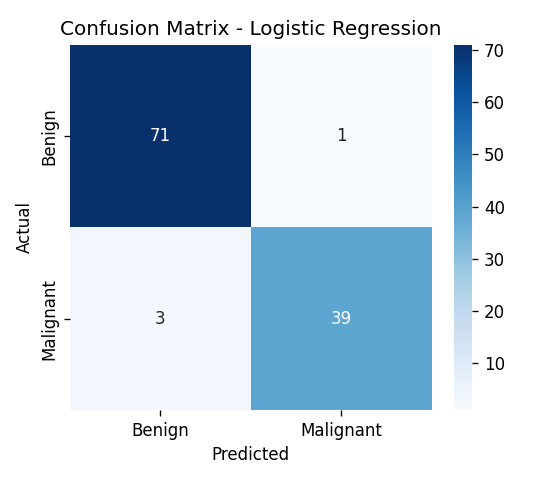
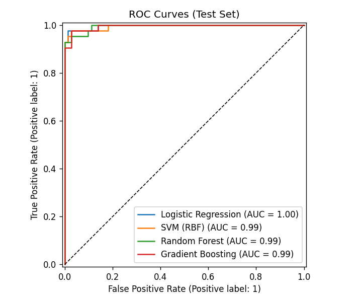
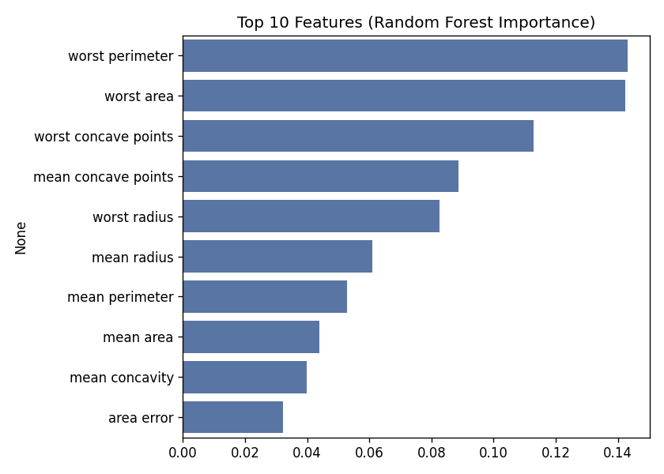

# 🩺 Breast Cancer Diagnosis Predictor (Machine Learning)

An end-to-end machine learning project that predicts whether a breast tumour is **benign** or **malignant** from 30 cell-nucleus measurements, with a model-comparison pipeline, evaluation reports, a CLI, and an interactive **Streamlit** web app.

> ⚠️ Educational project only — not a medical diagnostic tool.

## Problem Statement
Early and accurate detection of breast cancer improves outcomes. This project builds a classifier on the Wisconsin Diagnostic Breast Cancer dataset and prioritises **recall on the malignant class**, since missing a cancer (false negative) is far more costly than a false alarm.

## Dataset
- **Source:** Wisconsin Diagnostic Breast Cancer (UCI), bundled with scikit-learn — no download needed
- **Size:** 569 samples, 30 numeric features, 0 missing values
- **Classes:** 357 benign, 212 malignant
- **Features:** mean, standard error and "worst" values of radius, texture, perimeter, area, smoothness, compactness, concavity, concave points, symmetry and fractal dimension

## Approach
1. **EDA** – class balance, missing-value check, feature correlation heatmap
2. **Preprocessing** – stratified 80/20 train-test split, `StandardScaler` inside a scikit-learn `Pipeline` (prevents data leakage)
3. **Models compared** – Logistic Regression, SVM (RBF), Random Forest, Gradient Boosting
4. **Model selection** – 5-fold stratified cross-validation on F1 score, tie-break on recall
5. **Evaluation** – accuracy, precision, recall, F1, ROC-AUC, confusion matrix, ROC curves, feature importance
6. **Deployment** – saved model (`joblib`) served through a CLI and a Streamlit app

## Results (held-out test set, 114 samples)
| Metric | Score |
|---|---|
| Accuracy | 96.5% |
| Precision (malignant) | 97.5% |
| Recall (malignant) | 92.9% |
| F1 score | 95.1% |
| ROC-AUC | 0.996 |

**Best model:** Logistic Regression (CV F1 = 0.964)

| Model | CV Recall | CV F1 |
|---|---|---|
| Logistic Regression | 0.953 | 0.964 |
| SVM (RBF) | 0.947 | 0.961 |
| Gradient Boosting | 0.947 | 0.955 |
| Random Forest | 0.935 | 0.946 |

### Visuals




## Project Structure
```
breast-cancer-ml/
├── app.py                 # Streamlit web app
├── requirements.txt
├── src/
│   ├── train.py           # EDA, training, model comparison, evaluation
│   └── predict.py         # Command-line predictions
├── models/
│   ├── model.joblib       # Trained pipeline (scaler + model)
│   └── metadata.json      # Metrics, feature info
└── reports/figures/       # Generated plots
```

## How to Run
```bash
# 1. Install dependencies
pip install -r requirements.txt

# 2. Train (re-generates model and figures)
python src/train.py

# 3. Predict from the command line
python src/predict.py --sample 0
python src/predict.py --csv your_data.csv

# 4. Launch the web app
streamlit run app.py
```

## Web App Features
- **Single prediction:** adjust 30 sliders and see the malignant probability update live
- **Batch prediction:** upload a CSV and download predictions
- **Model performance:** view metrics and evaluation charts

## Tech Stack
Python · scikit-learn · pandas · NumPy · Matplotlib · Seaborn · Streamlit · joblib

## Future Improvements
- Hyperparameter tuning with `GridSearchCV` / Optuna
- SHAP values for per-prediction explanations
- Threshold tuning to push malignant recall higher
- Docker container and cloud deployment

## Author
_Your Name_ — [GitHub](https://github.com/your-username) · [LinkedIn](https://linkedin.com/in/your-profile)
